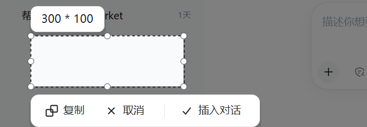

# DSH Screenshot

The capture entry has two possible homes: a camera button in the composer tool row, and a **Screenshot** row in the composer `+` menu (the Doubao arrangement). Either one drags a region (the chrome mirrors Doubao's capture tool), confirms, and the PNG lands in the draft as an image attachment. Both places ship enabled; the **Screenshot entry** row in that same menu switches between menu only, button only, or both.

**Windows only.** The overlay is a Windows PowerShell + WinForms window; other platforms are refused explicitly (HTTP 501) instead of failing silently.



## Usage

1. Pick **Screenshot** in the `+` menu (or the camera button, depending on where you put the entry).
2. Drag a region; a single click on a window picks that window, with a dashed hover preview.
3. The selection stays editable: drag inside it to move, drag the eight white round handles to resize.
4. Confirm with `Enter`, a double-click inside the selection, or the **Insert into chat** pill. **Copy** only fills the clipboard (label flashes 已复制) without closing. **Cancel** / `Esc` discards.
5. The image appears in the composer; type your question and send.

### Where the entry lives

The `+` menu carries a **Screenshot entry** row with three options; a pick applies immediately and is remembered in browser localStorage across restarts:

- **Both places** (default) — button plus menu row.
- **`+` menu only** — the button retracts, leaving one menu row, exactly like Doubao (it sits at the end of the 指令 group, so a short window may need a small scroll).
- **Toolbar button only** — just the camera button left of the composer.

Chrome: everything outside the selection is dimmed by half while the region keeps its brightness; a dark dashed outline, eight white round handles, a white rounded size chip outside the top-left corner, and a white rounded action bar under the selection holding three identical items (Copy / Cancel / Insert into chat). No toasts.

## Install

- **Locally**: drop this directory into `default-workspace/` and mount it through `cordis.patch.yml` — that is how it currently runs.
- **From the plugin market**: see below.

## Publishing to the plugin market

The DSH plugin market is a **JSON index** (format 1), not an app-store upload: host the index at any HTTPS URL, and users add that URL as an index source in the plugin market to find and install this bundle.

1. Push to a public repository (GitHub et al.) containing this directory.
2. Build the index:
   ```
   node market/build-index.mjs --repo https://github.com/<you>/dsh-screenshot
   ```
   With a git checkout, `commit`, `publishTimestamp` and the URL default to `HEAD`, the commit date and the `origin` remote; `--commit`, `--timestamp` and `--path` (package subdirectory) override them.
   For npm, use `--npm --registry https://registry.npmjs.org` — that also requires actually publishing the package and renaming `name` to your own scope.
3. Upload the resulting index to any HTTPS static host (GitHub Pages, object storage, your own domain). This repository already serves one:

   ```
   https://mbcc5732.github.io/dsh-screenshot/index.json
   ```

4. Add that URL as an index source in the plugin market. Installs use a pinned spec like
   `git+https://github.com/mbcc5732/dsh-screenshot.git#<40-hex-commit>`.

Republishing after a code change: commit, push, then rebuild `docs/index.json` from the new HEAD and push it again.

```
git add . && git commit -m "..." && git push
node market/build-index.mjs --out docs/index.json
git add docs/index.json && git commit -m "index: rebuild" && git push
```

`market/example.index.json` is the sample produced from an example repository; its shape passes DSH's own validator (`parseMarketIndex` from `@deepseek-ai/dsh-plugin-market-index`).

Listing in the official index is curated by the DeepSeek team; this repository has no self-serve entry point.

## Permissions and implementation

- Keeps one resident `powershell.exe` (`capture.ps1 -Serve`) preheated, so a click costs ~130–220ms. It exits with the host, and closes any open overlay within a second if the host disappears.
- Captures the whole desktop (per-monitor DPI v2, native pixels on scaled displays), crops to the selection, writes a PNG into `%TEMP%\dsh-screenshot-tool`, hands the bytes back and deletes the file at once; the clipboard keeps a copy.
- Only the pixels you framed are uploaded; no other window leaks into the attachment.

## Docs

- `docs/DETAIL.md` / `docs/DETAIL.zh.md` — behaviour and limits, item by item.
