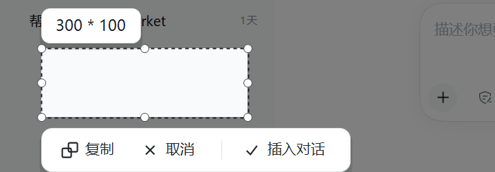

# DSH 对话截屏

截屏入口有两个位置：输入框工具栏的相机按钮，以及输入框「+」菜单里的「截图」一行（和豆包一样）。点任意一处都能拖出选区（界面与豆包截图工具一致），确认后 PNG 作为图片附件插入当前草稿。默认两处都放，可以用菜单里的「截图入口」切换成只放菜单或只放按钮。



**仅 Windows**：遮罩层是 Windows PowerShell + WinForms 窗口，其他平台会被显式拒绝（HTTP 501），不会悄悄失败。

## 用法

1. 点「+」菜单里的「截图」（或工具栏相机按钮，看你把入口放在哪）。
2. 拖框选区；只点一下某个窗口则选中该窗口，悬停时先用虚线框预览。
3. 松手后仍可编辑：框内按住拖动整体挪位，拖四角/四边白色圆手柄改大小。
4. `Enter`、框内双击、或工具条「✓ 插入对话」确认；「复制」只进剪贴板不关闭（标签短暂显示「已复制」）；「取消」/`Esc` 放弃。
5. 图片出现在输入框，写问题后正常发送。

### 入口位置

「+」菜单里有「截图入口」一项，三个选项，选完立刻生效（存在浏览器 localStorage，重启 DSH 也记得）：

- **两处都放**（默认）：按钮 + 菜单行。
- **仅“+”菜单**：按钮收起来，只留菜单行，和豆包一致（菜单行排在「指令」分组末尾，窗口太矮时需要往下滚一点）。
- **仅工具栏按钮**：光有输入框左侧的相机按钮。

界面：选区外整屏压暗 50%，选区内保持原亮度；深色细虚线选框、8 个白色圆形手柄、左上外侧白底圆角尺寸标签、选区下方白色圆角工具条（复制 / 取消 / ✓ 插入对话 三项同款样式，同一个 14dp 字重）。不弹任何提示气泡。

## 安装

- **本地**：把本目录放进 `default-workspace/`，用 `cordis.patch.yml` 挂载即可（当前就是这种用法）。
- **从插件市场上架/安装**：见下一节。

## 上架到插件市场

DSH 的插件市场是一份 **索引 JSON**（format 1），不是应用商店后台上传：把索引放到任意 HTTPS 可达地址，用户在插件市场里添加该地址作为「索引源」，就能搜到并安装本插件。

1. 推到公开仓库（GitHub 等），确保仓库里包含本目录全部文件。
2. 生成索引：
   ```
   node market/build-index.mjs --repo https://github.com/<you>/dsh-screenshot
   ```
   有 git 检出时 `commit`、`publishTimestamp`、`origin` 都会自动读取；也可显式传 `--commit` / `--timestamp` / `--path`（子目录）。
   npm 源用 `--npm --registry https://registry.npmjs.org`（需要先把包真的发到 npm，且把 `name` 改成你自己的 scope）。
3. `market/index.json`（或 `docs/index.json`）传到任意 HTTPS 静态地址（GitHub Pages、对象存储、自己域名都行）。本仓库的索引已经托管好：

   ```
   https://mbcc5732.github.io/dsh-screenshot/index.json
   ```

4. 在 DSH 插件市场里添加这个 URL 作为索引源，条目即可安装，安装 spec 形如
   `git+https://github.com/mbcc5732/dsh-screenshot.git#<40位commit>`。

重新发布（改了代码之后）：提交推送，然后用当前 HEAD 重新生成 `docs/index.json` 再推一次。

```
git add . && git commit -m "..." && git push
node market/build-index.mjs --out docs/index.json
git add docs/index.json && git commit -m "index: rebuild" && git push
```

`market/example.index.json` 是用示例仓库生成的样例，结构可通过 DSH 自带校验器（`@deepseek-ai/dsh-plugin-market-index` 的 `parseMarketIndex`）。

进官方索引需要 DeepSeek 团队收录，本仓库没有自助入口。

## 权限与实现说明

- 启动一个常驻 `powershell.exe`（`capture.ps1 -Serve`）做预热，点击延迟约 130–220ms；进程随宿主退出，宿主异常消失时遮罩 1 秒内自关。
- 全屏抓取当前桌面（per-monitor DPI v2，缩放屏按物理像素），选区裁剪后写 PNG 到 `%TEMP%\dsh-screenshot-tool`，字节读回后立即删除；剪贴板另留一份。
- 上传的是你自己圈定的那块像素，不会有其它窗口内容进入附件。

## 文档

- `docs/DETAIL.zh.md` / `docs/DETAIL.md`：逐项行为与限制说明。
